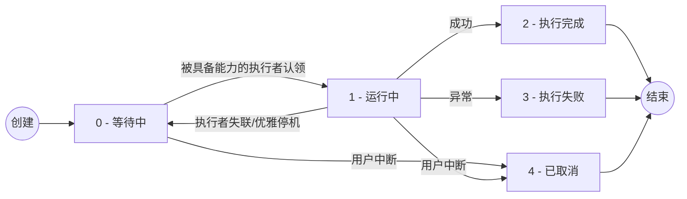

# 异步任务

## 1. 简述

异步任务可以让一些耗时较长的任务（如：视频编码转换、文件下载）放到后台运行而不阻塞请求，并提供了统一的任务控制接口。

咸鱼云异步任务框架支持**按任务类型路由调度**、**故障转移**、**紧急通道**、**进度监控**，并且 **core 节点与微服务实例共用同一套任务队列、调度机制与执行侧实现**：

- 调度与控制面位于 `sfc-core-task`：任务入队、类型路由认领、执行者健康检查、上报落库、中断路由、日志与进度查询、管理接口；
- 执行侧由 `microservices/sfc-task-worker`（下称 **Worker SDK**）提供：core 节点内嵌一个角色为 `CORE` 的 Worker，微服务实例各自内嵌一个角色为 `SERVICE` 的 Worker，二者使用同一套认领循环、线程池、上报与停机逻辑；
- 两端通过「服务发现 + 内部 HTTP（`/api/internal/task/**`）」交互，报文类型以 SDK 的 `protocol` 包为唯一来源。

任务系统以 **数据库队列为唯一事实来源**：所有任务都走同一条「入队 → 按类型认领 → 执行」的流程，不存在「本地直执行」旁路，因此**同一组提交参数（`immediate` / `isTemp`）在 core 本地任务与微服务任务上的行为完全一致**。

执行者是否存活、支持哪些任务类型，统一以**服务注册中心**（`local` 进程内注册表 / `nacos`）为准。

> 微服务接入指引见 [微服务异步任务 Worker 接入](../microservice/async-task-worker.md)。

> **代码组织**：
> - 契约与模型：`sfc-api`（`com.sfc.task`：`AsyncTask`、`AsyncTaskFactory`、`AsyncTaskManager`、`AsyncTaskRecord`、仓库接口等）；
> - 调度与控制面：`sfc-core-task`（同包名 `com.sfc.task`：`AsyncTaskFactoryRegistry`、`TaskClaimService`、`TaskHealthChecker`、`TaskReportService`、`TaskInterruptRouter`、`TaskLogBufferService`、管理接口 `/api/asyncTask/**` 与内部协议控制器 `/api/internal/task/**`）；
> - 执行侧 SDK：`microservices/sfc-task-worker`（`com.sfc.cloud.task.worker`：`SfcTaskWorkerRuntime`、`SfcTaskWorkerClient`、`SfcTaskExecution`、`SfcTaskReporter`、`SfcTaskWorkerRegistry`、`SfcTaskWorkerIdentity` 与 `protocol` 包）；
> - `sfc-core` 依赖上述两个模块，通过 `@EnableAsyncTask` 引入控制面，并由 `com.xiaotao.saltedfishcloud.task.worker.AsyncTaskWorkerConfiguration` 把容器中全部 `AsyncTaskFactory` 桥接为 SDK 的 `SfcTaskHandler`，内嵌 `CORE` 角色的 Worker。

## 2. 总体架构

### 2.1 角色

| 角色 | 说明 |
|---|---|
| 任务管理器 `com.sfc.task.AsyncTaskManager` | 任务系统唯一入口：任务提交、状态流转、日志/进度查询、中断控制、等待完成 |
| 任务执行者（Worker） | 实际执行任务的一方，由 Worker SDK 实现。**core 节点内嵌一个 Worker（角色 `CORE`），每个微服务实例内嵌一个 Worker（角色 `SERVICE`）**，两者的执行链路完全一致 |
| 服务注册中心 | 执行者能力与存活状态的唯一来源：`local`（进程内注册表，单节点）/ `nacos`（多节点共享）。系统通过 Spring Cloud `DiscoveryClient` 读取 |
| 任务认领服务 `TaskClaimService` | 按 Worker 支持的任务类型从数据库队列中原子认领任务，支持长轮询等待与紧急车道 |
| 健康检查 `TaskHealthChecker` | 周期检查运行中任务的执行者实例是否还在注册中心，失联时回收任务并重新发布（故障转移）；同时告警长期无人认领的任务 |
| 上报服务 `TaskReportService` | 接收执行者的执行上报（开始/进度/日志/完成/放弃），维护任务状态、运行日志缓冲与进度快照 |
| 中断路由 `TaskInterruptRouter` | 按任务记录的 `claimed_service` + `claimed_worker` 在注册中心定位执行者实例，向其内部中断端点下发指令 |

### 2.2 核心调度模型：类型路由认领 + 紧急车道

```
任务提交 ──► 写入 async_task_record（status = 0 等待中，priority = NORMAL / URGENT）
                    │
                    └─► 广播 async_task_publish 唤醒正在长轮询的执行者
                                │
        ┌───────────────────────┘
        ▼
 Worker 认领循环（core 内嵌 Worker / 微服务 Worker，规则完全一致）：
   有容量（运行中 + 已认领未开始 < max-concurrent-tasks）：
       SELECT ... WHERE status = 0 AND taskType IN (本 worker 支持的类型)
              ORDER BY priority DESC, create_at LIMIT 1
   满载：
       SELECT ... WHERE status = 0 AND taskType IN (...)
              AND priority >= URGENT ORDER BY create_at LIMIT 1   -- 只领紧急任务，不占并发槽位
   认领：
       UPDATE ... SET status = 1, claimed_service / claimed_worker / claimed_role = 本实例
       WHERE id = ? AND status = 0                                -- 乐观锁，并发只有一个成功
        │
        ▼
  执行任务（Worker SDK 线程池）──► 约 1 秒节流上报进度、按批上报运行日志
        │
        ▼
  上报最终状态（完成 / 失败 / 取消），或停机时上报放弃（任务回到队列）
```

关键点：

- **执行者只认领自己支持的任务类型**，不会出现「领到不支持的任务再退回」的情况；
- **并发容量由 `sfc.task.worker.max-concurrent-tasks` 槽位控制**（运行中任务数 + 已认领未开始任务数），与任务上的 `cpuOverhead` 无关；紧急任务绕过槽位限制（见 2.3）；
- 同类任务有多个执行者时通过数据库乐观锁竞争，天然负载分摊；
- **没有任何执行者支持的任务会一直排队等待**，不会丢失；健康检查会对「等待超过 5 分钟」的任务输出聚合告警
  （即使不知道具体哪个实例应该支持该类型，也能暴露「类型写错 / 服务未部署」）；
- 无任务时认领以**长轮询**等待，新任务发布广播会立即唤醒等待者，避免高频空转轮询数据库；
- Worker 启动后先做两项自检：内部接口鉴权是否已配置、能否定位 sfc-core；认领线程还会等待「本实例已在服务注册中心可见」（最多 60 秒）。任一项不满足都会打印 ERROR 并禁用认领，应用继续运行（详见第 9 节）。

### 2.3 紧急通道（immediate）

提交参数 `immediate=true` 的任务以 **紧急优先级**（`priority = 100`）入队，与普通任务走完全相同的队列与执行链路，区别只在认领策略：

| 执行者状态 | 普通任务 | 紧急任务 |
|---|---|---|
| 有容量 | 认领（紧急任务优先级更高，会先被拿走） | 认领 |
| 满载 | 暂停认领 | **仍然认领并执行**（不占用并发槽位） |

因此「要求立即处理」的任务不会被执行者自身的并发上限挡住；同时它是任务级属性，与任务实现位于 core 还是微服务无关。

> 满载时 SDK 会把认领请求的等待时间自动缩短为不超过 3 秒，容量释放后回到普通车道。

## 3. 任务类型与执行者能力

| 执行者 | 任务类型来源 | 存活判定 |
|---|---|---|
| core 节点内嵌 Worker（角色 `CORE`） | 容器中所有 `AsyncTaskFactory` Bean 的 `getTaskType()`（由 `AsyncTaskWorkerConfiguration` 桥接为 `SfcTaskHandler`） | 本节点实例是否在服务注册中心可见 |
| 微服务内嵌 Worker（角色 `SERVICE`） | 容器中所有 `SfcTaskHandler` Bean 的 `taskType()` | 该微服务实例是否在服务注册中心可见（临时实例心跳 / TTL 由注册中心维护） |

- **能力随认领请求上报**：每次 `claim` 都会携带本实例支持的任务类型集合与角色，执行者无需单独注册能力或额外发送心跳；
- **同一实例内任务类型不允许重复**：`SfcTaskWorkerRegistry` 在启动时校验，类型为空或重复会直接抛出异常，避免路由歧义；
- **未发现任何任务类型**的实例只打印 WARN，不会认领任务；
- **存活判定只信服务注册中心**：运行中任务记录 `claimed_service + claimed_worker`（serviceId + `host:port`），健康检查据此判断执行者是否还在线；
- `GET /api/asyncTask/listWorker`（仅管理员）返回注册中心里的实例视图：**当前节点自身**会标注角色 `CORE` 并给出其支持的任务类型，其他实例的角色与类型为空。该接口列出的是注册中心中的全部服务实例，不限于任务执行者，用于排查「执行者是否在线」。

> 单节点部署可使用 `sys.service.registry-provider=local`（进程内注册表）；
> **多个 core 节点部署必须使用 `nacos`**（`sys.service.registry-provider=nacos`），否则各节点互相看不到对方的实例，
> 健康检查会把其他节点执行的任务误判为失联。微服务侧同样需要注册到与 core 相同的注册中心。
>
> Worker 的 `workerId` 统一为服务注册信息中的 `host:port`；取不到注册信息时会退化为本机地址并告警，
> 这种实例不在注册中心中，core 会把它认领的任务误判为失联并回收。

## 4. 数据表与状态机

### 4.1 数据表

- 异步任务记录：`async_task_record`
- 异步任务日志记录：`async_task_log_record`

`async_task_record` 关键字段：

| 字段 | 说明 |
|---|---|
| `task_type` | 任务类型，路由调度的依据 |
| `params` | 任务参数（复杂对象建议使用 JSON 字符串） |
| `status` | 任务状态，见 4.2 |
| `priority` | 任务优先级：`0` 普通、`100` 紧急（`immediate=true`）。紧急任务满载时也会被认领 |
| `cpu_overhead` | 任务的 CPU 开销指数（100 = 1 个 CPU 核心的算力），随任务下发给执行者留作扩展；调度与并发由执行者的 `max-concurrent-tasks` 控制，不按该值换算容量 |
| `claimed_service` | 认领该任务的服务名（服务发现中的 serviceId），与 `claimed_worker` 一起用于存活判定与中断寻址 |
| `claimed_worker` | 认领该任务的执行者实例地址（`host:port`） |
| `claimed_role` | 认领者角色：`CORE`（core 节点）/ `SERVICE`（微服务实例），供管理接口展示与排障使用；中断统一下发方式为按服务发现定位地址后走内部 HTTP，与角色无关 |
| `claimed_at` | 认领时间 |
| `last_report_at` | 执行者最后一次上报时间（诊断用） |
| `retry_count` | 故障转移重试次数 |
| `executor` | 执行者描述信息，便于排查 |
| `is_temp` | 是否为临时任务（临时任务**只影响故障转移行为**：执行者失联/放弃即置失败，不重试） |

> 项目默认 `spring.jpa.hibernate.ddl-auto=update`，新增字段会自动加列。若需要为新查询补索引，可手工执行：
>
> ```sql
> CREATE INDEX idx_async_task_record_claim ON async_task_record (status, priority, task_type, create_at);
> ```

### 4.2 状态机

- `0` - 等待中：任务提交后的初始状态，等待具备能力的执行者认领
- `1` - 运行中：已被执行者认领（`claimed_worker` 非空）
- `2` - 执行完成
- `3` - 任务失败
- `4` - 任务被取消（用户中断）
- `5` - 任务离线：保留的状态值；当前调度模型下执行者失联的任务会被健康检查回收为等待中



## 5. 自定义异步任务（core 宿主侧）

core 节点内嵌的 Worker 以 `CORE` 角色参与认领，任务类型来自容器中的 `AsyncTaskFactory` Bean；
`AsyncTaskFactory` 会由 `AsyncTaskWorkerConfiguration` 桥接为 Worker SDK 的 `SfcTaskHandler` 执行。
编写自定义任务只需实现 `AsyncTask` 与 `AsyncTaskFactory` 两个接口。

### 5.1 创建任务执行类

新建一个类实现接口 `com.sfc.task.AsyncTask`，样例：

```java
package com.sfc.task.demo;

import com.sfc.task.AsyncTask;
import com.sfc.task.prog.ProgressRecord;
import com.xiaotao.saltedfishcloud.helper.CustomLogger;

import java.io.OutputStream;

public class MyTask implements AsyncTask {
    private CustomLogger logger;
    private final String originParams;
    private Thread workThread;
    private boolean running;
    private final ProgressRecord progressRecord = new ProgressRecord();

    public MyTask(String originParams) { this.originParams = originParams; }

    @Override
    public void execute(OutputStream logOutputStream) {
        running = true;
        try {
            // 标记任务总量与完成量，进度与执行速度系统会自动更新
            progressRecord.setTotal(1).setLoaded(0);

            // 封装日志流
            logger = new CustomLogger(logOutputStream);

            // 解析具体的参数，注意: 参数必须确保能通过字符串反序列化得到，复杂参数对象推荐使用json
            int time = Integer.parseInt(originParams);

            // 任务执行
            logger.info("开始睡觉 " + time + "ms");
            workThread = Thread.currentThread();
            Thread.sleep(time);
        } catch (Exception e) {
            throw new RuntimeException(e);
        } finally {
            logger.info("睡醒了");
            running = false;
            progressRecord.setLoaded(1);
        }
    }

    @Override
    public void interrupt() {
        // 中断方法非常重要，必须尽最大努力确保任务能被正确终止
        if (running) {
            logger.warn("任务被中断");
            workThread.interrupt();
        }
    }

    @Override
    public boolean isRunning() { return running; }

    @Override
    public String getParams() { return originParams; }

    @Override
    public ProgressRecord getProgress() {
        // 应当返回对象引用以便让外部更新进度和速度
        return progressRecord;
    }
}
```

执行语义（由 `AsyncTaskFactoryHandler` 桥接）：

- `execute(OutputStream)` 收到的日志流由 SDK 按行缓冲、批量上报，任务结束时残余内容随结束上报一起提交；
- core 下发的中断指令会调用任务的 `interrupt()`；任务执行期间收到中断、最终正常返回时，结果按**取消**上报；
- 执行前会把任务创建者绑定到当前线程的安全上下文（`SecureUtils.bindUser`），执行结束解绑；
- `getProgress()` 返回的完整进度快照（含自定义字段）会作为进度扩展信息上报，前端 `getProg` 接口中这些字段与 `loaded` / `total` 同级返回。

### 5.2 创建任务工厂

实现接口 `com.sfc.task.AsyncTaskFactory`。任务实例可能需要依赖 Spring 容器中的 Bean，在这里可以手动完成依赖装配：

```java
package com.sfc.task.demo;

import com.sfc.task.AsyncTask;
import com.sfc.task.AsyncTaskFactory;
import com.sfc.task.model.AsyncTaskRecord;

public class MyTaskFactory implements AsyncTaskFactory {
    @Override
    public AsyncTask createTask(String params, AsyncTaskRecord asyncTaskRecord) {
        return new MyTask(params);
    }

    @Override
    public String getTaskType() {
        // !!! 非常重要 !!! 这是一类异步任务的唯一身份标识，也是调度路由的依据
        return "my-task";
    }
}
```

### 5.3 注册工厂

工厂必须被注册到任务系统，执行者才会声明支持该任务类型。注册方式：

1. 直接标注 `@Component`（推荐，需在包扫描路径下）；
2. 通过 Spring 配置类以 `@Bean` 方式注入；
3. 手动注册：注入 `com.sfc.task.AsyncTaskManager` 后调用 `registerFactory(factory)`。

> 容器中的 `AsyncTaskFactory` Bean 会同时注册到 `AsyncTaskFactoryRegistry`（管理接口据此展示任务类型）
> 并桥接为 `SfcTaskHandler` 供内嵌 Worker 认领，无需额外操作。

### 5.4 提交任务

构造 `AsyncTaskRecord` 后通过 `AsyncTaskManager` 提交：

```java
import com.sfc.task.AsyncTaskManager;
import com.sfc.task.model.AsyncTaskRecord;

public class SleepService {
    @Autowired
    private AsyncTaskManager asyncTaskManager;

    public void submitTask(Long time) throws IOException {
        AsyncTaskRecord asyncTaskRecord = AsyncTaskRecord.builder()
                // 任务名称，可随意设置
                .name("睡觉任务: 睡" + time + "毫秒")
                // 任务类型，需要与任务工厂的 getTaskType 对应
                .taskType("my-task")
                // 设定参数，复杂对象可用 json
                .params(time + "")
                // 预设 CPU 开销指数，1 个 CPU 核心为 100
                .cpuOverhead(20)
                .build();

        // 提交任务（写入队列，由具备能力的执行者认领）
        asyncTaskManager.submitAsyncTask(asyncTaskRecord);
    }
}
```

> 也可以使用 `asyncTaskManager.createTask(...)` 快捷创建并提交（参数为 `AsyncTaskCreateParam`）。
>
> 两个提交语义参数：
> - `immediate`：`true` 时以紧急优先级入队，执行者满载也会优先执行（见 2.3）；
> - `isTemp`：`true` 表示临时任务，只影响故障转移行为——执行者失联或主动放弃执行权时直接置为失败，不参与重试。
>
> 两者都**不会改变任务的执行链路**，任务始终由「具备该类型的执行者」认领执行，与实现位于 core 还是微服务无关。

## 6. 任务管理

### 6.1 任务中断

```java
asyncTaskManager.interrupt(taskId);
```

- 等待中的任务：直接置为已取消；
- 运行中的任务：按任务记录的 `claimed_service` 查询服务注册中心，用 `claimed_worker`（`host:port`）匹配到执行者实例，
  向其 `POST /api/internal/task/interrupt` 下发中断指令。**core 内嵌 Worker 与微服务 Worker 走同一条路径**；
- 收到中断指令后，SDK 触发中断标记与回调；即使任务实现「吞掉」中断信号并正常返回，最终状态也会被置为**已取消（4）**；
- 执行者已从注册中心消失时直接取消任务，避免出现无法中断的「僵尸任务」；服务发现查询失败时不贸然取消，由调用方重试；
- 中断是**尽力而为**的：任务实现应周期性调用 `checkInterrupted()` 或注册中断回调，否则只能等待任务自然结束。

### 6.2 日志获取

```java
asyncTaskManager.getTaskLog(taskId, true);
```

返回 `Resource`，通过 `getInputStream()` 获取日志内容。日志分两部分：

- **运行中日志**：执行者按批上报（每行缓冲、约 1 秒 flush 一次，单批最多 500 行），core 写入运行日志缓冲区；
  运行中任务的日志查询会拼接该缓冲区内容；
- **历史日志**：任务结束时，结束上报携带尚未上报的尾部日志（最多 5000 行）；core 把它与缓冲区中剩余日志统一写入
  `async_task_log_record`，因此任务完成后可回看完整日志。

实时监听日志：`listenLog(taskId, consumer)` / `removeLogListen(listenId)`，底层使用 MQ 主题，每次上报的日志行会同步推送。

> ⚠️ **多 core + 本地缓存（`sys.service.cache-provider=local`）的限制**：
> 运行中日志缓冲区保存在**接收该次上报的 core 节点**的缓存中，而 Worker 的每次请求经负载均衡落到某个
> core 实例（多实例默认轮询），
> 因此请求落到其他 core 节点时可能查不到运行中日志。多 core 部署应使用共享缓存（`cache-provider=redis`，默认），
> 需要跨节点实时监听日志时还应使用共享 MQ（`mq-provider=redis`）。历史日志落库后不受此限制。

### 6.3 进度获取

```java
asyncTaskManager.getProgress(taskId);
```

返回统一的任务进度快照（包含系统计算的每秒执行速度）。进度由执行者按约 1 秒的节流周期上报，core 写入任务进度缓存：

- 任务处理器只更新 `getProgress()` 的 `loaded` / `total` 时，上报的就是这两个值，速度由 SDK 根据两次采样的差值计算；
- core 内嵌 Worker 会把任务的完整进度快照（含扩展字段）一起上报，SDK 从快照中取 `loaded` / `total`（`speed` 仍由 SDK 计算），
  其余字段作为**进度扩展信息**（协议字段 `extensions`）写入缓存；`/api/asyncTask/getProg` 响应中这些扩展字段与
  `loaded` / `total` 同级展开，接口形态保持不变；
- 微服务任务处理器通常只需要更新 `getProgress()` 的 `loaded` / `total`；
- 进度快照在缓存中保留 10 秒，任务结束后短时间仍可读取，过期后查询返回空。

> 与 6.2 相同，多 core + `cache-provider=local` 时进度快照也只在接收上报的 core 节点可见。

### 6.4 等待任务完成 / 重新运行

- `waitTaskExit(taskId, timeout, timeUnit)`：阻塞等待任务结束（内部通过任务退出广播实现，集群/微服务场景均有效）；
- `rerun(taskId)`：以原任务参数创建一个新任务重新执行。

### 6.5 HTTP 接口一览

| 接口 | 方法 | 说明 |
|---|---|---|
| `/api/asyncTask/listRecord` | GET | 分页查询任务记录（支持按 uid、状态、任务类型过滤） |
| `/api/asyncTask/getById` | GET | 查询单个任务 |
| `/api/asyncTask/getProg` | POST | 批量查询任务进度 |
| `/api/asyncTask/getLog` | GET | 获取任务日志 |
| `/api/asyncTask/interrupt` | POST | 中断任务 |
| `/api/asyncTask/rerun` | POST | 重新运行任务 |
| `/api/asyncTask/waitTaskExit` | GET | 阻塞等待任务结束 |
| `/api/asyncTask/listWorker` | GET | **管理员**：查看服务注册中心里的实例（当前节点会标注 `CORE` 并给出支持的任务类型） |

## 7. 故障转移与重试

- **存活判定以服务注册中心为唯一依据**：运行中任务记录 `claimed_service + claimed_worker`（serviceId + `host:port`），
  健康检查每 30 秒扫描一次运行中任务，若该实例已不在注册中心（进程崩溃、停机、网络断开导致注册信息过期），视为执行者失联；
- 失联任务的处理：保存已有运行日志 → **普通任务**重置为等待中并重新发布（`retry_count + 1`，超过上限 3 次置为失败）；
  **临时任务**（`is_temp = true`）不参与重试，直接置为失败并写入失败日志；
- **优雅停机由 Worker 运行时统一处理**：core 内嵌 Worker 与微服务 Worker 完全相同——停止认领（认领线程可能阻塞在长轮询上，
  运行时最多等待约 15 秒让其退出）→ 对运行中任务上报放弃（普通任务回到队列由其他实例接管，临时任务直接失败）→
  最多等待数秒让执行线程响应中断后退出 → 对停机窗口内新登记的执行上下文补报放弃；
- **进程异常退出/强制终止后的遗留任务由执行者启动恢复兜底**：执行者身份是 `host:port`，同端口重启后与上次进程相同，
  因此本实例启动后、开始认领前会把 `claimed_service + claimed_worker` 指向自己的运行中任务按故障转移规则回收
  （普通任务重新排队、临时任务置失败），避免任务永远停留在运行中；
- 服务发现查询异常时本轮跳过判定，避免把「注册中心抖动」误判为执行者失联而批量回收任务；
- 长时间无人认领的等待任务（超过 5 分钟）会被健康检查按类型聚合告警（10 分钟最多一次），用于发现任务类型写错或执行者未部署。

## 8. 服务间内部协议

执行者与调度面通过 `/api/internal/task/**` 交互（受 `sfc-auth` 服务间调用凭证保护，网关拒绝该前缀）。
core 内嵌 Worker 的自调用同样走该前缀：core 的用户会话安全配置已放行该前缀，服务间协议不使用用户登录态。
**报文类型以 Worker SDK 的 `com.sfc.cloud.task.worker.protocol` 包为唯一来源**：core 的 `TaskWorkerInternalController`
与 `TaskInterruptRouter` 直接复用该包的类型，两端共用同一份定义，避免字段漂移。完整接入方式见
[微服务异步任务 Worker 接入](../microservice/async-task-worker.md)。

| 接口 | 说明 |
|---|---|
| `POST /api/internal/task/claim` | 按任务类型认领任务（长轮询，携带 `serviceId`、`workerId`、`role`，支持只认领紧急任务） |
| `POST /api/internal/task/submit` | 以指定用户身份提交任务（支持 `immediate` / `isTemp`） |
| `POST /api/internal/task/report/start` | 上报任务开始执行 |
| `POST /api/internal/task/report/progress` | 上报任务进度（含可选 `extensions` 扩展字段） |
| `POST /api/internal/task/report/log` | 上报任务运行日志（按批） |
| `POST /api/internal/task/report/finish` | 上报任务结束（完成/失败/取消，可携带尾部日志） |
| `POST /api/internal/task/report/abandon` | 上报放弃执行权（普通任务回到队列，临时任务置失败） |
| `POST /api/internal/task/interrupt` | **执行者侧提供**：core 下发中断指令 |

> 所有内部接口均为 POST；执行者出站请求由 SDK 自动携带内部调用凭证，
> core 与微服务的 `sfc.internal.key`（环境变量 `SFC_INTERNAL_KEY`）必须一致。

## 9. 部署与运维要点

### 9.1 内部接口密钥（单机部署也必须配置）

core 内嵌 Worker 通过内部 HTTP 调用本机（或其他 core 节点）的 `/api/internal/task/**` 完成认领与上报，
因此**即使是单机部署、未启用任何微服务，也必须配置 `sfc.internal.key`（环境变量 `SFC_INTERNAL_KEY`）**：

- 未配置时，服务端拒绝全部 `/api/internal/**` 请求（fail-closed，启动日志打印 ERROR）；
- 内嵌 Worker 自检 `isAuthConfigured()` 失败，启动日志打印 ERROR 并**自动禁用认领**（应用继续运行，但任务不会被 core 执行）；
- 密钥不得少于 32 个字符，core 与所有微服务必须使用同一份密钥。

### 9.2 服务发现与定位

- Worker 经 Spring Cloud LoadBalancer 按服务名（`sfc.task.worker.core-service-id`，默认 `sfc-core`）从注册中心
  选取 core 实例，多实例默认轮询；每次出站请求（认领/上报/提交）重新选路，**不支持直连兜底地址**；
- 因此 Worker 所在服务必须注册到与 core 相同的注册中心；未启用服务发现/负载均衡时 Worker 启动自检失败，
  打印 ERROR 并停止认领（应用继续运行）；
- 认领前会自检「本实例已在注册中心可见」，最多等待 60 秒；超时后打印 ERROR 并停止认领（应用继续运行）。
  出现该日志时应检查服务名、namespace、group 是否与 core 一致。

### 9.3 并发与容量

- 执行者并发容量 = `sfc.task.worker.max-concurrent-tasks`（core 的部署配置默认 `64`，可用环境变量
  `SFC_TASK_MAX_CONCURRENT_TASKS` 覆盖；SDK 缺省值为 CPU 核数）；
- 普通任务受槽位限制；紧急任务（`immediate=true`）不受限制，因此实际并发可能短暂超过该值；
- 执行线程池核心线程数等于槽位数，最大可扩展到 1024 个线程（紧急任务使用）。

### 9.4 多节点部署

- **多个 core 节点必须使用 `nacos`**（`sys.service.registry-provider=nacos`），否则节点间互相看不到实例，健康检查会误回收任务；
- 多 core 部署应使用共享缓存（`cache-provider=redis`）与共享 MQ（`mq-provider=redis`）；
  使用本地缓存/本地 MQ 时，运行中日志与进度快照只在接收上报的节点可见（见 6.2、6.3）；
- 微服务同样需要注册到与 core 相同的注册中心，并配置相同的 `SFC_INTERNAL_KEY`。

### 9.5 常见日志与现象

| 现象 / 日志 | 含义与处理 |
|---|---|
| `未配置内部接口鉴权密钥（sfc.internal.key / 环境变量 SFC_INTERNAL_KEY）... Worker 已禁用` | 配置密钥后重启（单机也需要） |
| `未启用服务发现/负载均衡能力（未找到 DiscoveryClient 或 LoadBalancerClient）... Worker 已禁用` | 为 Worker 所在服务启用服务发现与负载均衡，并注册到与 core 相同的注册中心 |
| `等待 60 秒后仍未在服务注册中心中发现本实例，已停止认领任务` | 注册中心配置不一致（服务名/namespace/group）或注册失败 |
| `未发现任何 SfcTaskHandler Bean，本实例不会认领任何任务` | 本实例没有可执行的任务类型；检查处理器是否被扫描 |
| `存在 N 个等待超过 5 分钟仍未被执行者认领的任务（按类型: ...）` | 任务类型写错或对应执行者未部署 |
| `发现 N 个本实例上次退出时遗留的运行中任务，开始回收` | 上次进程未优雅退出；启动恢复会按故障转移规则重新排队或置失败，无需人工处理 |
| `认领线程在 15000ms 内未退出，继续停机流程` | 停机时认领长轮询仍未返回；遗留任务由健康检查或下次启动恢复兜底 |
| 任务长时间保持运行中并提示「执行者可能已失联或中断指令下发失败」 | 执行者已不在注册中心，或中断指令下发失败；可查看健康检查回收日志 |
