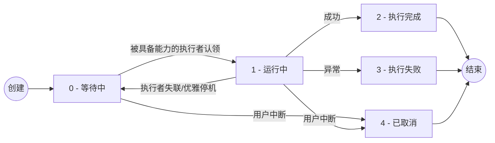

# 异步任务

## 1. 简述

异步任务可以让一些耗时较长的任务（如：视频编码转换、文件下载）放到后台运行而不阻塞请求，并提供了统一的任务控制接口。

在咸鱼云网盘异步任务框架下，支持**按任务类型路由调度**、**故障转移**、**进度监控**，并且 **core 节点与微服务实例共享同一套任务队列与调度机制**：
微服务只需要实现一个任务处理器（handler），即可把耗时任务交给统一的异步任务系统调度执行，任务状态、进度、日志、中断、重试全部由 core 统一管理。

> 微服务接入指引见 [微服务异步任务 Worker 接入](../microservice/async-task-worker.md)。

> **代码组织**：契约与模型位于 `sfc-api`（`com.sfc.task`：`AsyncTask`、`AsyncTaskFactory`、`AsyncTaskManager`、`AsyncTaskRecord`、仓库接口等），
> 框架实现位于独立模块 `sfc-core-task`（同包名 `com.sfc.task`：调度、执行器、Worker、健康检查、上报协议、管理接口）；
> `sfc-core` 依赖该模块，并在启动类通过 `@EnableAsyncTask` 引入。

## 2. 总体架构

### 2.1 角色

| 角色 | 说明 |
|---|---|
| 任务管理器 `com.sfc.task.AsyncTaskManager` | 任务系统唯一入口：任务提交、状态流转、日志/进度查询、中断控制、等待完成 |
| 任务执行者（Worker） | 实际执行任务的一方。**core 节点本身也只是一个 Worker**（`LOCAL_NODE`），微服务实例是 `REMOTE_SERVICE` 类型的 Worker |
| 执行者注册中心 `TaskWorkerRegistryService` | 保存每个 Worker 的**任务类型能力**、负载、回调地址与心跳，是类型路由调度的数据来源 |
| 任务认领服务 `TaskClaimService` | 按 Worker 声明的任务类型从数据库队列中原子认领任务，支持长轮询等待 |
| 健康检查 `TaskHealthChecker` | 周期检查运行中任务的执行者是否存活，执行者失联时回收任务并重新发布（故障转移） |
| 上报服务 `TaskReportService` | 接收微服务 Worker 的执行上报（开始/进度/日志/完成/放弃），使其与本地任务在管理层完全一致 |

### 2.2 核心调度模型：类型路由认领

```
任务提交 ──► 写入 async_task_record（status = 0 等待中）──► 广播 async_task_publish 唤醒等待者
                                                                │
        ┌───────────────────────────────────────────────────────┘
        ▼
 Worker 认领循环（core 本地 / 微服务）：只查询「自己声明支持的任务类型」
   SELECT ... WHERE status = 0 AND taskType IN (本worker支持的类型) ORDER BY createAt LIMIT 1
   UPDATE ... SET status = 1, claimedWorker = 本worker WHERE id = ? AND status = 0   -- 乐观锁，并发只有一个成功
        │
        ▼
 执行任务（本地线程池 / 微服务 SDK）──► 上报进度、日志、最终状态
```

关键点：

- **执行者只认领自己支持的任务类型**，不存在「抓到不支持的任务再退回」的情况；
- 同类任务有多个执行者时通过数据库乐观锁竞争，天然负载分摊；
- **没有执行者支持的任务会一直排队等待**，不会丢失；健康检查会告警「某任务类型当前没有存活执行者」；
- 无任务时认领以**长轮询**等待（默认最多 30 秒），新任务发布广播会立即唤醒等待者，避免高频空转轮询数据库；
- 执行者满载（`currentLoad >= maxLoad`）时暂停认领。

## 3. 任务类型与执行者能力

| 执行者 | 任务类型来源 | 注册方式 |
|---|---|---|
| core 本地节点 | 容器中所有 `AsyncTaskFactory` Bean 的 `getTaskType()` | 启动时自动注册，之后每 10 秒心跳续约（类型/负载变化自动同步） |
| 微服务实例 | 容器中所有 `SfcTaskHandler` Bean 的 `taskType()` | Worker SDK 启动时注册，之后按心跳周期续约 |

> 只有存在**存活执行者**的任务类型才能被执行。提交任务前请确认对应的执行者已上线
> （`GET /api/asyncTask/listWorker` 可查看，仅管理员）。

## 4. 数据表与状态机

### 4.1 数据表

- 异步任务记录：`async_task_record`
- 异步任务日志记录：`async_task_log_record`

`async_task_record` 关键字段：

| 字段 | 说明 |
|---|---|
| `task_type` | 任务类型，路由调度的依据 |
| `params` | 任务参数（复杂对象建议使用 JSON 字符串） |
| `status` | 任务状态，见 4.2 |
| `cpu_overhead` | 任务的 CPU 开销指数（100 = 1 个 CPU 核心的算力），影响执行者并发与负载判断 |
| `claimed_worker` | 认领该任务的执行者标识（core 节点为 `node-{节点id}`，微服务为 worker 实例id） |
| `claimed_at` | 认领时间 |
| `last_report_at` | 执行者最后一次上报时间 |
| `retry_count` | 故障转移重试次数 |
| `executor` | 执行者描述信息，便于排查 |
| `is_temp` | 是否为临时任务（临时任务不参与故障转移重试） |

> 项目默认 `spring.jpa.hibernate.ddl-auto=update`，新增字段会自动加列。若需要为新查询补索引，可手工执行：
>
> ```sql
> CREATE INDEX idx_async_task_record_claim ON async_task_record (status, task_type, create_at);
> ```
>
> **注意**：本版本的调度模型已与旧版本不兼容（新增认领相关字段、删除旧的执行权保持机制），升级时请清空
> `async_task_record` 与 `async_task_log_record` 中的旧任务数据。

### 4.2 状态机

- `0` - 等待中：任务提交后的初始状态，等待具备能力的执行者认领
- `1` - 运行中：已被执行者认领（`claimed_worker` 非空）
- `2` - 执行完成
- `3` - 任务失败
- `4` - 任务被取消（用户中断）
- `5` - 任务离线：保留状态值，用于标识「执行者失联且未及回收」的历史数据；新调度模型下任务失联会被直接回收为等待中



## 5. 自定义异步任务（core 宿主侧）

### 5.1 创建任务执行类

新建一个类实现接口 `com.sfc.task.AsyncTask`，样例：

```java
package com.sfc.task.demo;

import com.sfc.task.AsyncTask;
import com.sfc.task.prog.ProgressRecord;
import com.xiaotao.saltedfishcloud.helper.CustomLogger;

import java.io.OutputStream;

public class MyTask implements AsyncTask {
    private CustomLogger logger;
    private final String originParams;
    private Thread workThread;
    private boolean running;
    private final ProgressRecord progressRecord = new ProgressRecord();

    public MyTask(String originParams) { this.originParams = originParams; }

    @Override
    public void execute(OutputStream logOutputStream) {
        running = true;
        try {
            // 标记任务总量与完成量，进度与执行速度系统会自动更新
            progressRecord.setTotal(1).setLoaded(0);

            // 封装日志流
            logger = new CustomLogger(logOutputStream);

            // 解析具体的参数，注意: 参数必须确保能通过字符串反序列化得到，复杂参数对象推荐使用json
            int time = Integer.parseInt(originParams);

            // 任务执行
            logger.info("开始睡觉 " + time + "ms");
            workThread = Thread.currentThread();
            Thread.sleep(time);
        } catch (Exception e) {
            throw new RuntimeException(e);
        } finally {
            logger.info("睡醒了");
            running = false;
            progressRecord.setLoaded(1);
        }
    }

    @Override
    public void interrupt() {
        // 中断方法非常重要，必须尽最大努力确保任务能被正确终止
        if (running) {
            logger.warn("任务被中断");
            workThread.interrupt();
        }
    }

    @Override
    public boolean isRunning() { return running; }

    @Override
    public String getParams() { return originParams; }

    @Override
    public ProgressRecord getProgress() {
        // 应当返回对象引用以便让外部更新进度和速度
        return progressRecord;
    }
}
```

### 5.2 创建任务工厂

实现接口 `com.sfc.task.AsyncTaskFactory`。任务实例可能需要依赖 Spring 容器中的 Bean，在这里可以手动完成依赖装配：

```java
package com.sfc.task.demo;

import com.sfc.task.AsyncTask;
import com.sfc.task.AsyncTaskFactory;
import com.sfc.task.model.AsyncTaskRecord;

public class MyTaskFactory implements AsyncTaskFactory {
    @Override
    public AsyncTask createTask(String params, AsyncTaskRecord asyncTaskRecord) {
        return new MyTask(params);
    }

    @Override
    public String getTaskType() {
        // !!! 非常重要 !!! 这是一类异步任务的唯一身份标识，也是调度路由的依据
        return "my-task";
    }
}
```

### 5.3 注册工厂

工厂必须被注册到任务系统，执行者才会声明支持该任务类型。注册方式：

1. 直接标注 `@Component`（推荐，需在包扫描路径下）；
2. 通过 Spring 配置类以 `@Bean` 方式注入；
3. 手动注册：注入 `com.sfc.task.AsyncTaskManager` 后调用 `registerFactory(factory)`。

### 5.4 提交任务

构造 `AsyncTaskRecord` 后通过 `AsyncTaskManager` 提交：

```java
import com.sfc.task.AsyncTaskManager;
import com.sfc.task.model.AsyncTaskRecord;

public class SleepService {
    @Autowired
    private AsyncTaskManager asyncTaskManager;

    public void submitTask(Long time) throws IOException {
        AsyncTaskRecord asyncTaskRecord = AsyncTaskRecord.builder()
                // 任务名称，可随意设置
                .name("睡觉任务: 睡" + time + "毫秒")
                // 任务类型，需要与任务工厂的 getTaskType 对应
                .taskType("my-task")
                // 设定参数，复杂对象可用 json
                .params(time + "")
                // 预设CPU开销，1个CPU核心为100算
                .cpuOverhead(20)
                .build();

        // 提交任务（写入队列，由具备能力的执行者认领）
        asyncTaskManager.submitAsyncTask(asyncTaskRecord);
    }
}
```

> 也可以使用 `asyncTaskManager.createTask(...)` 快捷创建并提交（参数为 `AsyncTaskCreateParam`）。

## 6. 任务管理

### 6.1 任务中断

```java
asyncTaskManager.interrupt(taskId);
```

- 等待中的任务：直接置为已取消；
- 运行中的任务：按任务的认领者路由中断请求——本地任务直接中断、其他 core 节点通过集群 RPC 中断、微服务通过 HTTP 回调中断；
- 执行者已失联时直接取消任务，避免出现无法中断的「僵尸任务」。

### 6.2 日志获取

```java
asyncTaskManager.getTaskLog(taskId, true);
```

返回 `Resource`，通过 `getInputStream()` 获取日志内容。运行中任务的日志来源按执行者类型自动选择
（本地日志文件 / 运行日志缓冲 / 集群 RPC），调用方无需关心。

实时监听日志：`listenLog(taskId, consumer)` / `removeLogListen(listenId)`。

### 6.3 进度获取

```java
asyncTaskManager.getProgress(taskId);
```

返回统一的任务进度快照（包含系统计算的每秒执行速度）。本地任务由进度探测器计算，微服务任务由 SDK 计算后周期性上报，
上层接口完全一致。

### 6.4 等待任务完成 / 重新运行

- `waitTaskExit(taskId, timeout, timeUnit)`：阻塞等待任务结束（内部通过任务退出广播实现，集群/微服务场景均有效）；
- `rerun(taskId)`：以原任务参数创建一个新任务重新执行。

### 6.5 HTTP 接口一览

| 接口 | 方法 | 说明 |
|---|---|---|
| `/api/asyncTask/listRecord` | GET | 分页查询任务记录（支持按 uid、状态、任务类型过滤） |
| `/api/asyncTask/getById` | GET | 查询单个任务 |
| `/api/asyncTask/getProg` | POST | 批量查询任务进度 |
| `/api/asyncTask/getLog` | GET | 获取任务日志 |
| `/api/asyncTask/interrupt` | POST | 中断任务 |
| `/api/asyncTask/rerun` | POST | 重新运行任务 |
| `/api/asyncTask/waitTaskExit` | GET | 阻塞等待任务结束 |
| `/api/asyncTask/listWorker` | GET | **管理员**：查看存活执行者（类型、负载、心跳） |

## 7. 故障转移与重试

- 每个执行者每 10 秒重新注册（心跳）一次，注册信息有效期 30 秒；
- 健康检查每 30 秒扫描运行中任务：若其认领者注册信息已过期（执行者宕机/网络失联），则保存已有日志、
  把任务重置为等待中并重新发布；
- 任务重试次数记录在 `retry_count`，达到上限（默认 3 次）后置为失败，避免任务在故障节点间无限循环；
- **优雅停机**：执行者停止时先停止认领，再把正在执行的任务重置回队列（微服务通过 `report/abandon` 上报），
  任务由其他节点或重启后的实例继续执行；
- 临时任务（`is_temp = true`）不参与故障转移重试，执行者失联时直接置为失败。

## 8. 服务间内部协议

core 对微服务 Worker 暴露 `/api/internal/task/**` 内部接口（受 `sfc-auth` 服务间调用凭证保护，网关拒绝该前缀），
完整协议与接入方式见 [微服务异步任务 Worker 接入](../microservice/async-task-worker.md)。

| 接口 | 说明 |
|---|---|
| `POST /api/internal/task/worker/register` | 注册/续约执行者（能力、负载、回调地址） |
| `POST /api/internal/task/worker/unregister` | 注销执行者 |
| `POST /api/internal/task/claim` | 按任务类型认领任务（长轮询） |
| `POST /api/internal/task/submit` | 以指定用户身份提交任务 |
| `POST /api/internal/task/report/start` | 上报任务开始执行 |
| `POST /api/internal/task/report/progress` | 上报任务进度 |
| `POST /api/internal/task/report/log` | 上报任务运行日志 |
| `POST /api/internal/task/report/finish` | 上报任务结束（完成/失败/取消） |
| `POST /api/internal/task/report/abandon` | 上报放弃执行权（任务回到队列） |
| `POST /api/internal/task/interrupt` | **Worker 侧提供**：core 下发中断指令 |

## 9. 与旧调度机制的差异（升级提示）

| 项 | 旧机制 | 新机制 |
|---|---|---|
| 任务抓取 | 任何节点抓取任意等待任务，不支持时睡 1 秒后重新发布 | 按任务类型过滤认领，不存在任务弹跳 |
| 执行者模型 | core 集群节点专属（`AsyncTaskReceiver` + `AsyncTaskExecutor`） | 统一 Worker 模型：core 节点（LOCAL_NODE）+ 微服务（REMOTE_SERVICE） |
| 故障转移 | Redis 执行权保持标记 + 离线定时检查 + 队列丢失补偿 | Worker 心跳注册 + 健康检查回收重发 |
| 微服务接入 | 不支持 | Worker SDK（HTTP + 内部鉴权） |
| 数据兼容 | — | **不兼容**：需清理旧任务数据（见 4.1 注意） |
