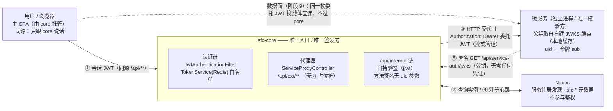
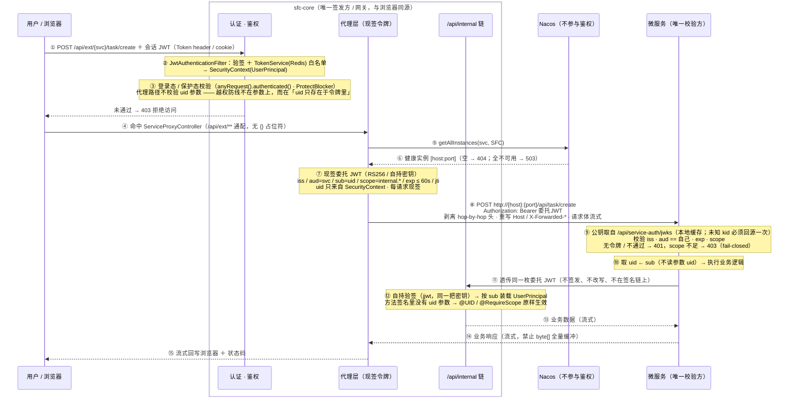

# 微服务鉴权 · 拓扑 / 泳道图

> **性质**：配套图件。对应的方案结论见[**服务鉴权机制设计**](../microservice-service-auth-design.md)、[路线图阶段 6/8/9](../microservice-roadmap.md)与[档位 3 设计](../microservice-phase3-frontend-integration.md)。
> **方案要点**：`sfc-core` 是**唯一签发方**（RS256 / **自持密钥**）；微服务是**唯一校验方**（公钥取自 **core 自建的匿名 JWKS 端点**，永不持有密钥材料）。整套机制**与 OIDC/OAuth 零耦合**。
> **渲染图**：[microservice-auth-topology-swimlane.png](microservice-auth-topology-swimlane.png)
> **修订日期**：2026-10-06（独立性调整：`/oauth2/jwks` → 自建 `/api/service-auth/jwks`；"复用现有 JWK" → 自持密钥；`/internal/**` → `/api/internal/**`）

---

## ① 部署拓扑

**读图要点**

| # | 关键点 |
|---|---|
| ① | 浏览器只跟 core 说话，**同源**，因此前端无需任何跨域与令牌处理改动 |
| ② ④ | Nacos 只承担注册发现与 `sfc.*` 自描述元数据，**不参与鉴权**（`sys.service.nacos.username/password` 只是注册中心自身的账号） |
| ③ | core 是唯一签发方：令牌在这里现签，微服务只接收 |
| ⑤ | 微服务的公钥来自 **core 自建的匿名端点** —— "密钥怎么安全地分发给微服务"这个问题不存在；且该端点**不依赖 OIDC**，`sys.oidc.enabled=false` 时照常可用 |
| 数据面 | 预签名直连时，浏览器直连微服务；core 只签发、不承载流量（流式代理仍是降级路径） |
| **独立性** | 委托令牌的密钥、JWKS 端点、作用域**全部自持**：不注入任何 OIDC bean、不打 `@ConditionalOnProperty("sys.oidc.*")`、不共用 `/oauth2/jwks` 与 `StandardScopes` |

---

## ② 泳道图（一次控制面请求的完整往返）

**阶段对应**：④⑤⑥⑧⑨⑩ = 阶段 8（控制面代理 ＋ 令牌签发）；⑪⑫⑬ = 阶段 6（档位 2 远程核心能力）；数据面旁路 = 阶段 9；⑤（拓扑图中那条匿名取公钥的边）= 阶段 5。

---

## ③ 关键性质（可据此自检）

1. **签发能力与校验能力不对称** —— 由算法（RS256 / JWKS）保证，**不由约定保证**。微服务永不持有密钥材料，因此"微服务被攻破 ≠ core 被攻破"真正成立（而不是换一把对称密钥继续共享）。
2. **全局唯一签发方是 core**。微服务只验签、只读 `sub`，不在签名链上 —— 不存在"服务身份令牌"这一类，也不存在共享对称密钥。
3. 收敛为一个令牌概念 · **一把自持密钥** · 一个校验规则（JWKS）· 一个授权模型（`@RequireScope` 机制 ＋ 独立的 `internal.*` 作用域）。
4. **无令牌一律 401（fail-closed）** —— 不把"微服务内网不可达"当作安全前提。
5. 数据面（阶段 9）不是第二套机制：它只是**同一枚委托令牌换了个载体**（query 而非 header），并额外做资源绑定与更长的有效期（5 分钟，非"一次性"）。
6. ⚠️ **`aud` 在两个校验方的规则不同**：微服务侧是 `aud == 自己`（图内 ⑨）；而 core 的 `/api/internal/**` 侧是 `aud ∈ 已注册服务名`（图内 ⑫）——令牌要被**透传回 core**，写成 `== sfc-core` 会让阶段 6 的链路直接断掉。详见[服务鉴权机制设计 · 决策 5](../microservice-service-auth-design.md)。
7. **与 OIDC/OAuth 零耦合**：自持密钥 ＋ 自建匿名端点 ＋ 独立作用域 ＋ 无 OIDC 条件注解。**验收方式**：`sys.oidc.enabled=false` 时，本图整条链路必须照常工作。
8. ⚠️ **`/api/internal/**` 的过滤器链必须始终注册**：`sys.service.auth.enabled=false` 或缺密钥时**一律 401**，不能让它落到主链（否则任何登录用户都能访问内部 API）。
